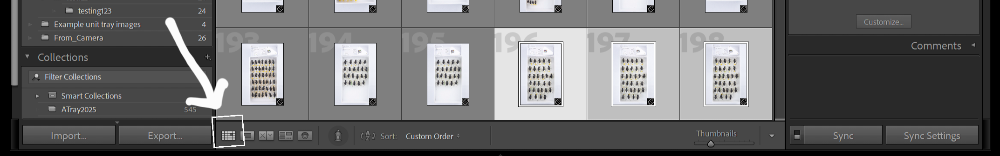
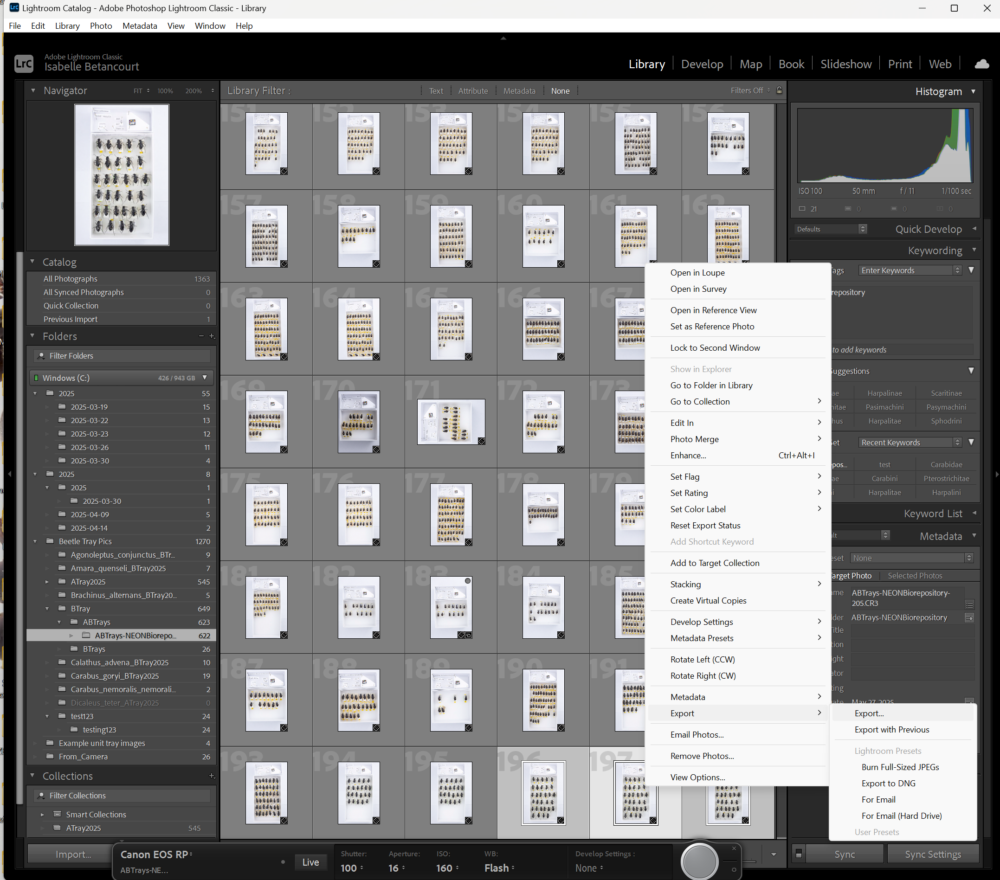
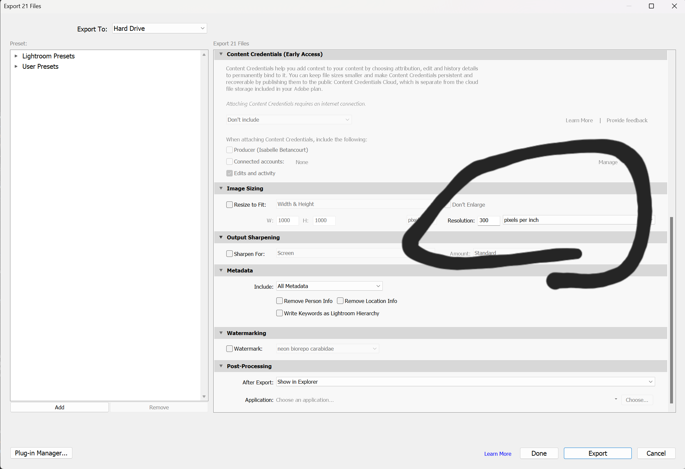
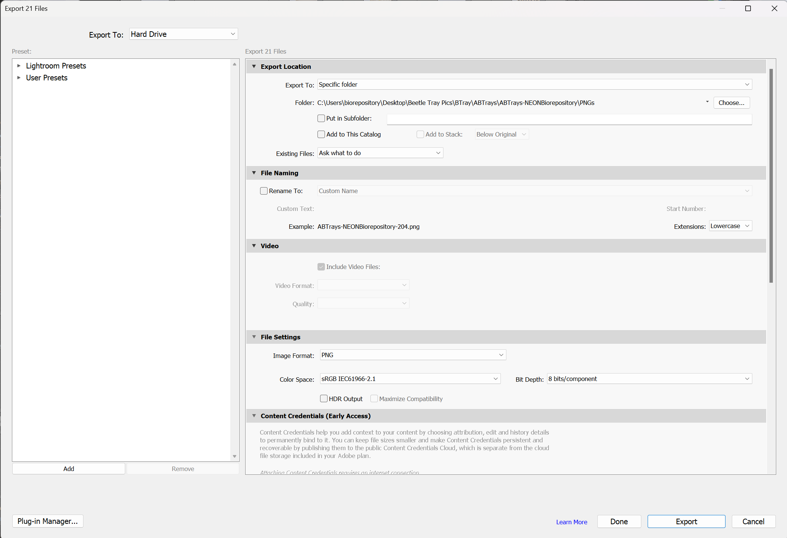

# Data Management

TODO: Short intro description and alt-text for ref photos.

## File Storage and Redundant Backup

- Save images using the default naming convention on the camera and record names in the metadata sheet for automated renaming.
    - This reduces the chance of mistranscription.
- Store images in at least two separate locations (primary storage and sharing).
    - Locally on the Computer, Google Drive, and [OSC](https://www.osc.edu/).
        - Google Drive is copied to OSC regularly with the following shell script. Replace `<PROJECT-CODE>` with your project code. The local directory should be set based on the HPC system used.

        ```bash
        #!/bin/bash

        # Exit if any command fails
        set -e

        # Set remote name and path
        REMOTE="GoogleDrive_NEONBeetle2"

        # Set local destination
        LOCAL_DIR="/fs/ess/<PROJECT-CODE>/CarabidImaging/" 

        # Use rclone to copy only new or updated files
        rclone copy "$REMOTE:" "$LOCAL_DIR" \
        --drive-export-formats xlsx \
        --update \
        --verbose \
        --exclude "*/Student/" \
        --log-file="$LOCAL_DIR/rclone_sync.log"
        ```

## Data Exports

- Locate the raw images in the computer's file system:
    `C:\Users\biorepository\Desktop\Beetle Tray Pics\BTray\ABTrays\ABTrays-NEONBiorepository\`
- Select all of the Raw photos (`.CR3` files) and copy them to the Google Drive in the folder `/Images/Raw/`.
- In Lightroom, select all photos from the date of imaging   
    - Click the grid view (looks like a grid of boxes at the bottom left of the interface):
     
    and use ++shift++ `+ click` to select all images of interest  
- Right-click on selected images and select “Export”:
  
- Export as `PNG` (This export takes a while).
    - Ensure that the PPI is assigned to 300:
    
    - Don’t modify the names  
    - Export in the folder: `C:\\Users\\biorepository\\Desktop\\Beetle Tray Pics\\BTray\\ABTrays\\ABTrays-NEONBiorepository\\PNGs`
      
- Once the export is done, select all PNGs and upload them to the Google Drive in the folder `/Images/PNG/`
