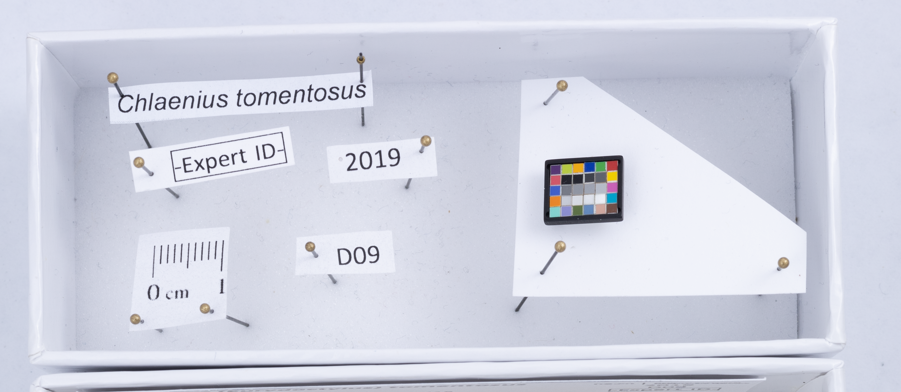
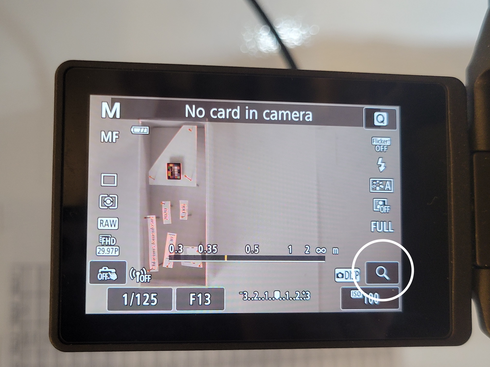
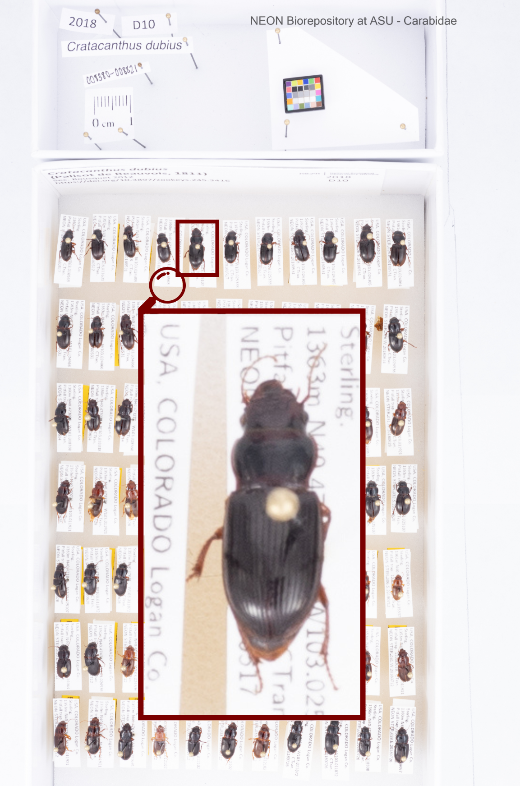
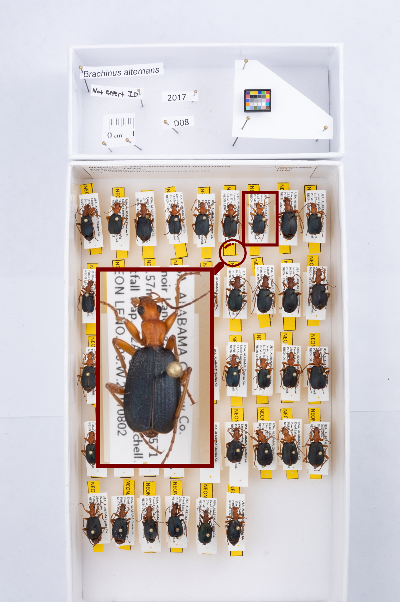
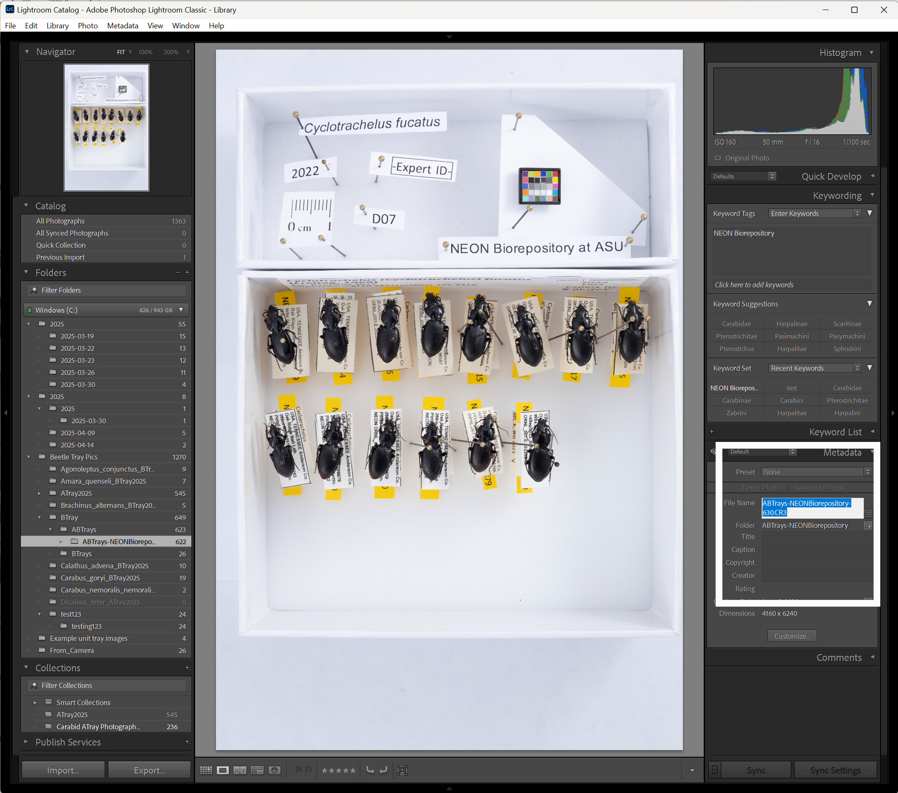

# A or B Tray

TODO: Add description and alt-text for image capture ref photo. Should some of this move to the overview page?

## Required Elements in Each Image

- Header tray configuration, use C Tray for easy pinning and orginization
{ loading=lazy } 
    - Place cm scale in same focal plane as specimens.
    - Include color calibration chart in each image.
    - Include domain label visible in frame.
    - Ensure species label is clearly visible.
    - Include expert or parataxonomist label.

## Image Capture

- Zoom into an individual beetle with the magnifying glass on the bottom right of the touch screen

- Manually focus on the specimen  
- Focus carefully on the top of the specimens, not labels or pins  
- Take test shot and review for proper exposure, focus, and framing  
- Ensure all required elements are visible in frame  
- Capture final image and verify quality before proceeding  
    - To verify, zoom in on individual beetle to ensure it is clear and in focus, see example photos

| EXAMPLE IMAGE: Photo looks okay from a full frame view, but when you zoom in you can see poor focus on the beetles showing blurry specimen details  |
| :---- |
| **EXAMPLE IMAGE: Example of good focus**  |

## Metadata

Metadata for each image needs to be transcribed into a spreadsheet in addition to being in the photo itself. Use [BeetleMetadata](https://docs.google.com/spreadsheets/d/1B1DY-XNBfE_NjbIqkmnTm5fE7PDNGqbasVlfrOypspc/edit?usp=drive_link)[^1] (column values defined on `ColumnNames` tab). Each image will constitute a row in the spreadsheet with a column to include:

- `imageID` \- copy and paste this from light lightroom 
  
- First two "individualIDs" and last 2 "individualIDs" in the tray (This is necessary for redundancy in case of mistranscription. If one ID is incorrect, the whole photo could be rendered unusable.)  
    - In the metadata google sheets I have embedded a lot of conditional formatting so that there are visual cues of problems  
        - red cells: the `IndividualID` is the wrong length  
        - orange cells: `IndividualID_1`  when `IndividualID_n` is numerically lower than `IndividualID_1`, eg the box is out of order  
- Number of individuals in the tray (`NumberOfBeetles`).
- `Marked`: Record “yes” once the header label of the unit tray has been marked with a pen to denote that imaging has occurred  
- `checkedOrder`: Record “yes” once you have ensured that all individualIDs are sequential.
- Expert or paratax box (Must be explicitly labeled one way, not left blank).
- `scientificName`

    !!! success

        `ExpertOrPara`, `domainID`, and importantly `scientificName` are all formatted as defined ranges that reference lists of real values (such as the species list, pulled from the API) so that there can't be any spelling errors and appear as drop downs that can be typed in, but will not fill it they are invalid values. 

- `domainID`  
- `Photographer`  
- `DatePhotographed`

[^1]: Copy this [Metadata Spreadsheet Template](https://docs.google.com/spreadsheets/d/1B1DY-XNBfE_NjbIqkmnTm5fE7PDNGqbasVlfrOypspc/edit?usp=drive_link) to your Drive or use the [`xlsx` version](https://github.com/Imageomics/beetle-imaging-procedure/blob/main/docs/assets/Supplemental–Template.xlsx) provided in the GitHub repo.
