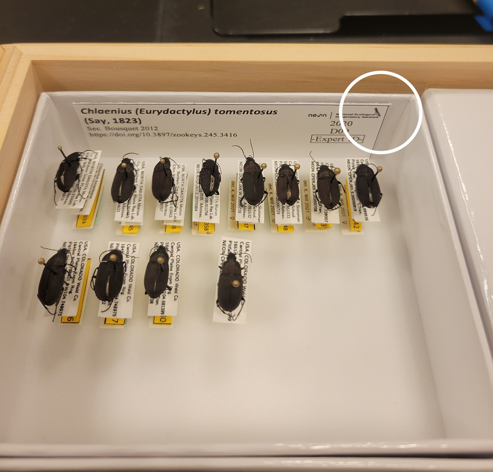

# Beetle Imaging Protocol Overview

TODO: Describe different senarios (trays, small beetle -- each is a subpage)

## Specimen Arrangement
 
- **FIRST CHECK**: If beetles are on paper points, use the [Small Beetle Protocol](small-beetle-protocol.md).
- Position beetles with consistent orientation in the tray.
- Position specimens in center of frame to minimize lens distortion.
- Check that specimens are in sequential order based on individual ID \#.
- **\*\*After imaging, mark the Upper right-hand corner of the unit tray header label**\*\*.

{ loading=lazy }

## Describe different senarios and link to the pages

## A or B Tray

## C Tray

## Small Beetle Protocol

## Data Linkage Checks

After imaging and the metadata connection processing has been completed, [manual quality checks](../manual-checks.md) should be run to ensure the specimens have been properly connected to their associated records.
