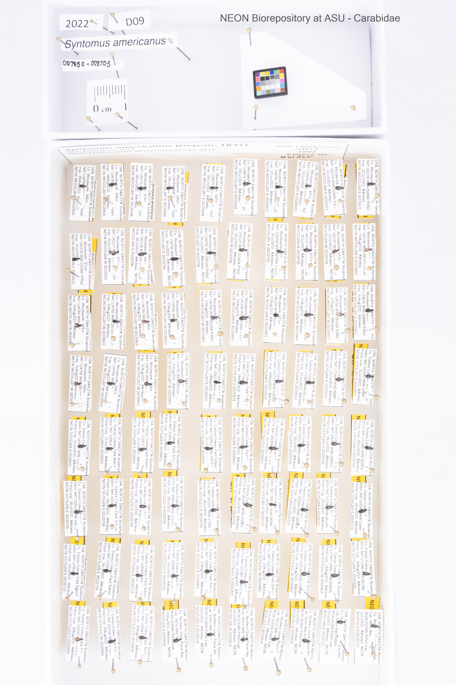
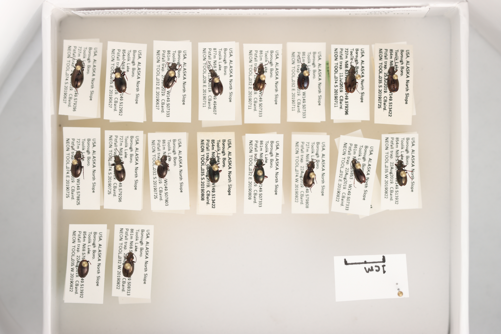

# Small Beetle Protocol

For beetles mounted on points that require higher magnification: TODO: Add example images.

| EXAMPLE IMAGE: this photo cannot be used due to the limited number of pixels that each beetle occupies, and confusion about appendages of the beetle vs background words on the labels.   |
| :---- |

## Equipment Setup

- Use a camera and macro lens with appropriate magnification:
    - Canon EOS DSLR (model 7D).
    - 24–105 mm macro lens.
- Use B Tray for rearranging A Trays where necessary.
- External flashes.
- Defusion paper, in a cone that extends from camera lens to table around tray (ref photo).

## Specimen Staging

- Only B and C Trays allow for appropriate magnification.
- Include a scale bar in **bottom right** of the container:

    - This is where there is most likely to be room to add in a scale bar, because of way beetles are arranged from top to bottom left to right.  
- Ensure that the scale bar is level with the beetles, and that all beetles are level with each other (in a single focal plane).
    - This is essential to measuring the size of the beetles, if the scale bar is above or below the beetles in height, the measurement will not be correct.  
- ensure beetles are sequentially based on individual ID numbers.
- Maintain consistent orientation for all specimens.
- Ensure that beetles are not on the edges of the photo to prevent distortion and poor focus. See example of poor focus:
[tray of small pinned beetles. The beetle in the top left of the image is surrounded by a black box with a diagonal line to a larger black box taking up most of the image, which is the beetle zoomed in and it is not in focus: gently fuzzy, particularly around the extremities and antennae. The text on the label pinned below the specimen is clearly out of focus](../assets/reference-photos/distorted.png)

## Image Capture

- Zoom into an individual beetle with the magnifying glass on the bottom right of the touch screen.
- Manually focus on the specimen.
- Use an F-stop of 5.6.
    - A lower f stop decreases the depth of field, and makes the label more blurry, allowing for segmentation of the beetle from the underlying text.
- Center the beetles in the images.
- Ensure the scale bare is not on the very edge of the photo (avoid distortion).
- Use flashes on TTL (automatic).
    - Ensure exposure looks good in the final image.

## Metadata for Small Beetles

For small beetles there is a separate [sheet](https://docs.google.com/spreadsheets/u/0/d/1TmRn9XfC6RGdB2jDjoCvcR9OfibCAyHCMSnOyvrvvgU/edit) in the metadata sheet called “SmallBeetles” (column values defined on [ColumnNames Sheet](https://docs.google.com/spreadsheets/d/1HzllCvC5AM32EYoPQCMOqpp4jjl9dML5_3RgFX2Qif0/edit?gid=628575869#gid=628575869)):

- Mark: Record “yes” once the header label of the unit tray has been marked with a pen to denote that imaging has occurred.
- If beetles need to be **temporarily** moved from an A Tray to a B Tray for imaging, record B under *trayType* add “From A tray” to the *notes* column, if they are permanently moved to a B tray, no note is necessary.   
- In some cases, you will not have 4 beetles for the individual ID records, in this case do the following:  
    - 1 Beetle: Record the IndividualID in *IndividualID_1* and enter NA to other columns.
    - 2 Beetles: Record the IndividualID in *IndividualID_1* and *IndividualID_n* and enter NA the middle columns (this is very important for querying).
    - 1 Beetles: Record the IndividualIDs in *IndividualID_1, IndividualID_2* and *IndividualID_n* and enter NA the middle column (this is very important for querying).
