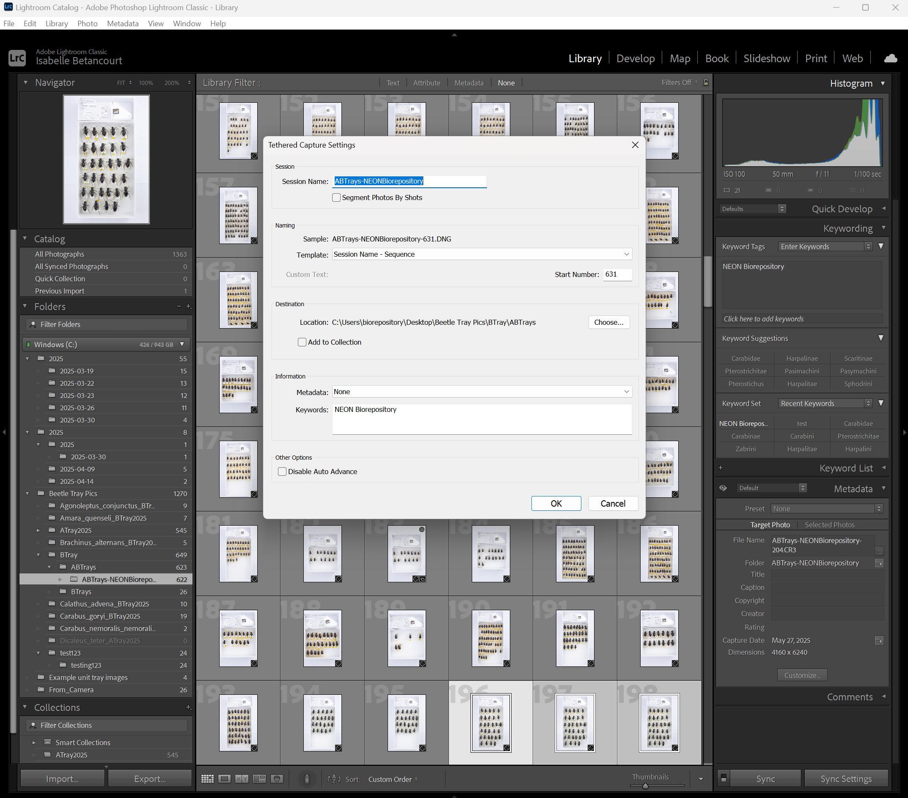
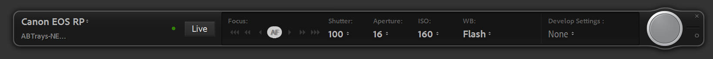
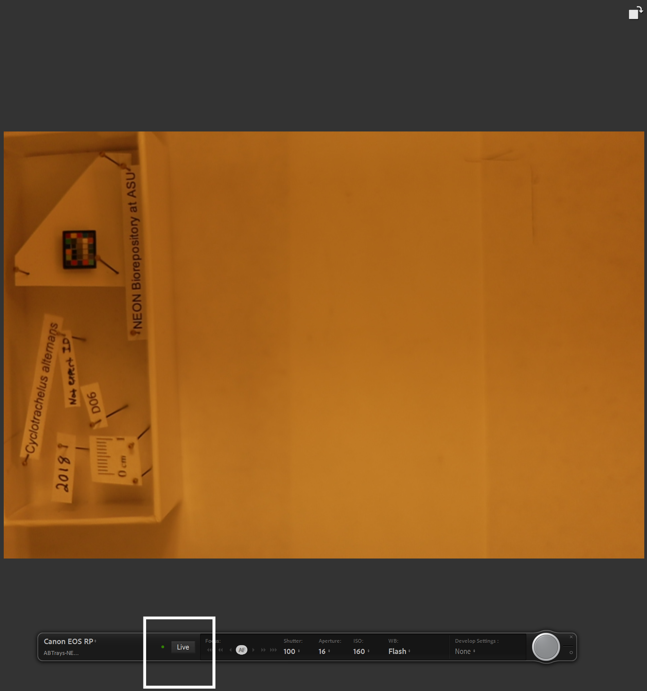
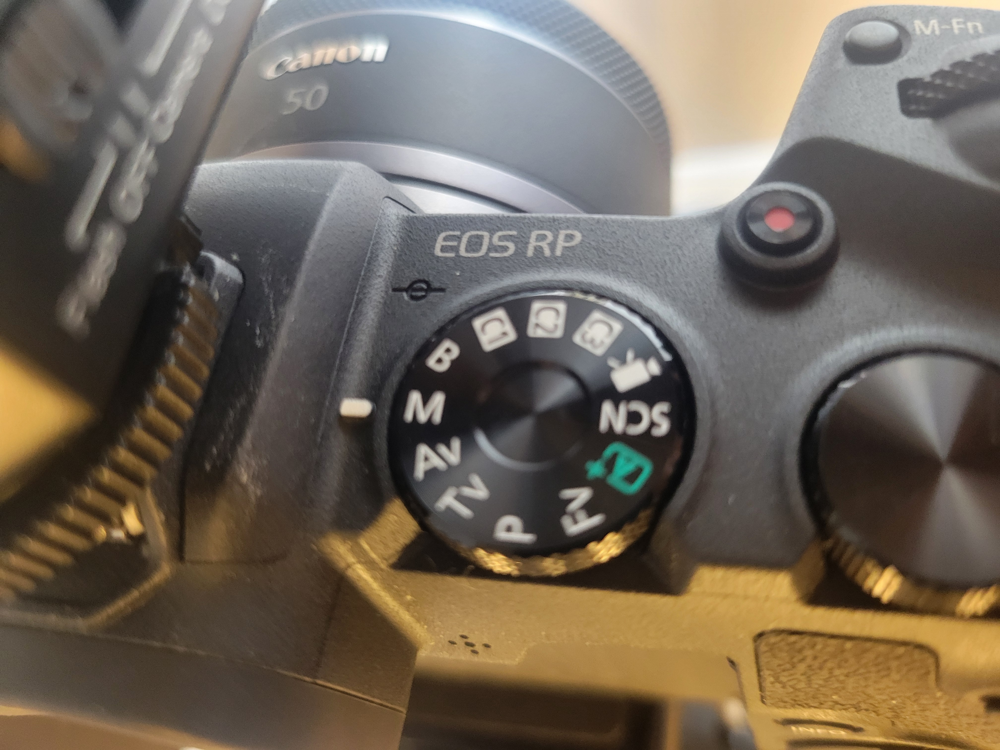
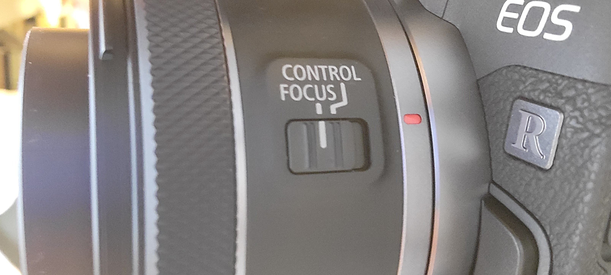

# Setup

This page covers everything needed to prepare the imaging station before photographing pinned ground beetles: cleaning and arranging equipment, configuring diffuse lighting, tethering the camera to Lightroom for direct capture to the workstation, and dialing in manual camera settings (aperture, ISO, and shutter speed) for sharp, well-exposed tray images.

## Setup Preparation

- Clean all equipment and work surfaces.
- Arrange diffuse lighting to minimize shadows and glare.
- Turn on lights.
- Put batteries in flashes and turn them on.

## Lightroom - Camera Tethering

- Turn on the Camera.
- Open Lightroom on the desktop.
- Link the Camera to Lightroom with tethering:
    - `File > Tethering > Start Tethering`
- Ensure that destination is `C:\Users\biorepository\Desktop\Beetle Tray Pics\BTray\ABTrays`:

- A control bar will open on the screen:
 
Open Live view to look at the camera view on the computer screen:

## Camera Settings

- Ensure the camera is in Manual (M) mode:
{ loading="lazy", width="75%" }
- Ensure that the lens is set to focus:
{ loading="lazy", width="75%" }
- Ensure the camera is set to manual focus.
- Adjust camera aperture settings from live view:
  
    - Use aperture settings that maximize depth of field (f/8-f/11) (Different for [small beetles](imaging-protocol/small-beetle-protocol.md)).
    - Use ISO settings that minimize noise (ISO 100-400) (recommendation, see what works for your setup).
    - Shutter Speeds for this camera generally work around 100-200, but it will depend on the species and ambient lighting.
